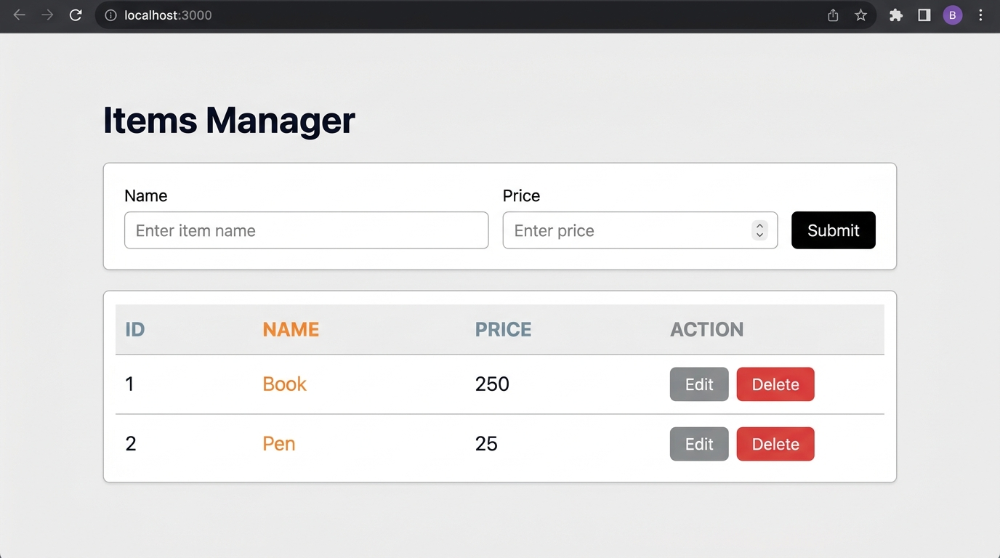

# MERN Lab Task 1 — Items Manager CRUD App

A hardened REST API-backed CRUD web app built with **Express.js**, **vanilla HTML/CSS/JS**, and atomic JSON file persistence.

## Screenshot



## Features

- **Create** — Add new items with name and price
- **Read** — View all items in a live-updating table
- **Update** — Edit any row inline via the form
- **Delete** — Remove items with confirmation prompt
- **Validation** — Client-side and server-side (empty name, negative price, price > 10M, XSS-safe)
- **Persistence** — Data saved to `items.json` (atomic write, survives restarts)
- **Double-click protection** — All buttons disabled while a request is in flight
- **Error handling** — Clear messages for network failures, 400/404/500 responses

## Project Structure

```
crud-app/
├── server.js          ← Express REST API
├── package.json
├── items.json         ← Auto-created persistent storage
├── screenshot.jpg
└── public/
    ├── index.html
    ├── style.css
    └── script.js
```

## Setup & Run

```bash
npm install
node server.js
```

Open **http://localhost:3000** in your browser.

## REST API

| Method | Endpoint         | Description       |
|--------|------------------|-------------------|
| GET    | `/api/items`     | Fetch all items   |
| POST   | `/api/items`     | Create a new item |
| PUT    | `/api/items/:id` | Update an item    |
| DELETE | `/api/items/:id` | Delete an item    |

Every error response follows the shape `{ "message": "reason" }`.

## Tech Stack

- **Backend:** Node.js, Express.js
- **Frontend:** HTML, CSS, JavaScript (Fetch API)
- **Storage:** JSON file (`items.json`) with atomic write
